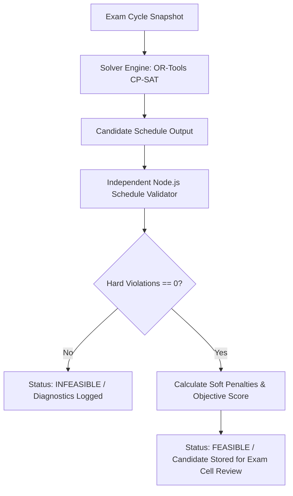

# Nexora Exam Scheduling Constraints Catalogue & Mathematical Model

**Document Version:** 1.0.0  
**Phase:** 6 — Scheduling Problem Model  
**Status:** Approved & Formally Specified  

---

## 1. Mathematical Formulation

Let the exam scheduling problem be formulated as a discrete constraint satisfaction and optimization problem (CSP/COP).

### 1.1 Sets and Indices
- $E = \{e_1, e_2, \dots, e_n\}$: Set of exams to be scheduled.
- $S = \{s_1, s_2, \dots, s_m\}$: Set of students registered for the examination cycle.
- $T = \{t_1, t_2, \dots, t_k\}$: Set of available discrete time slots.
  - Each slot $t \in T$ is defined by a tuple $(day_t, index_t, start_t, end_t)$ where $day_t \in \mathbb{N}$ and $index_t \in \mathbb{N}$.
- $R = \{r_1, r_2, \dots, r_p\}$: Set of available examination rooms/halls.
  - Each room $r \in R$ has capacity $cap(r) \in \mathbb{N}^+$.
- $I = \{i_1, i_2, \dots, i_q\}$: Set of faculty invigilators available.
- $E_s \subseteq E$: Set of exams enrolled by student $s \in S$.
- $S_e \subseteq S$: Set of students enrolled in exam $e \in E$, with count $|S_e|$.

### 1.2 Decision Variables
- $x_{e, t, r} \in \{0, 1\}$: Binary variable indicating whether exam $e \in E$ is scheduled in time slot $t \in T$ and room $r \in R$.
- Auxiliary variables:
  - $y_{e, t} = \sum_{r \in R} x_{e, t, r} \in \{0, 1\}$: Exam $e$ is scheduled at time slot $t$.
  - $z_{s, t} = \sum_{e \in E_s} y_{e, t}$: Number of exams student $s$ takes at time slot $t$.

---

## 2. Hard Constraints (Feasibility Criteria)

A schedule candidate is **feasible** if and only if zero hard constraint violations occur. Any schedule with even a single violation of H1–H5 is strictly rejected and cannot be published or approved.

### H1: Student Conflict-Free (No Clashes)
A student cannot sit for more than one examination at the exact same time slot.
$$\forall s \in S, \quad \forall t \in T: \quad \sum_{e \in E_s} \sum_{r \in R} x_{e, t, r} \le 1$$
- **Violation Code:** `STUDENT_OVERLAP`
- **Diagnostic Output:** Identifies conflicting student ID, slot ID, and conflicting exam IDs $[e_1, e_2]$.

### H2: Room Conflict-Free (No Double-Booking)
A room cannot host more than one distinct exam session at the same time slot (unless dedicated partitioned multi-cohort rules apply; standard unit booking enforces exclusivity).
$$\forall r \in R, \quad \forall t \in T: \quad \sum_{e \in E} x_{e, t, r} \le 1$$
- **Violation Code:** `ROOM_DOUBLE_BOOKED`
- **Diagnostic Output:** Identifies room ID, slot ID, and overlapping exam IDs $[e_a, e_b]$.

### H3: Room Capacity
The number of enrolled students for exam $e$ allocated to room $r$ must not exceed the maximum physical capacity of room $r$.
$$\forall e \in E, \quad \forall r \in R, \quad \forall t \in T: \quad x_{e, t, r} \cdot |S_e| \le cap(r)$$
- **Violation Code:** `ROOM_CAPACITY_EXCEEDED`
- **Diagnostic Output:** Identifies room ID, room capacity, exam ID, and enrolled student count.

### H4: Complete Paper Coverage (All Exams Scheduled Once)
Every registered exam offering $e \in E$ must be assigned to exactly one time slot and one valid examination room.
$$\forall e \in E: \quad \sum_{t \in T} \sum_{r \in R} x_{e, t, r} = 1$$
- **Violation Code:** `EXAM_UNSCHEDULED` or `EXAM_DUPLICATE_SCHEDULED`
- **Diagnostic Output:** Identifies unassigned or multi-assigned exam ID and code.

### H5: Invigilator Conflict-Free
An invigilator $i \in I$ cannot be assigned to more than one exam room in the same time slot, and cannot invigilate an exam belonging to their own primary teaching subject/offering if institutional policy forbids self-invigilation.
$$\forall i \in I, \quad \forall t \in T: \quad \sum_{e \in E} \sum_{r \in R} invig_{i, e, t, r} \le 1$$
- **Violation Code:** `INVIGILATOR_OVERLAP`
- **Diagnostic Output:** Identifies faculty ID, time slot ID, and conflicting assignments.

### H6: Strict Backlog & Regular Daily Separation (Max 1 Exam Per Student Per Day)
A student (whether regular or repeating backlog courses in Cycle 1, 2, or 3) **must never have more than one examination on the same calendar day**. If a student in 2nd year takes a 1st-year backlog paper, that backlog paper cannot occur on the same day as their 2nd-year paper.
$$\forall s \in S, \quad \forall d \in D: \quad \sum_{t \in T_d} \sum_{e \in E_s} y_{e, t} \le 1$$
- **Violation Code:** `STUDENT_SAME_DAY_CONFLICT`
- **Diagnostic Output:** Identifies student roll number, conflicting calendar date, and the list of scheduled exams $[e_1 (\text{Regular}), e_2 (\text{Backlog Cycle})]$.

### H7: Holiday & Institutional Recess Blackout
No examination session can be scheduled on official Gazetted Holidays, Institutional Holidays, or Sundays.
$$\forall t \in T_{\text{holidays}}: \quad \sum_{e \in E} y_{e, t} = 0$$
- **Violation Code:** `HOLIDAY_CLASH`
- **Diagnostic Output:** Identifies conflicting holiday title, blocked date, and scheduled exam offering.

---

## 3. Soft Constraints & Objective Function

Soft constraints do not invalidate feasibility, but penalize poor scheduling quality. The objective is to minimize total penalty:
$$\min \quad Z = W_{\text{spacing}} \cdot \mathcal{P}_{\text{spacing}} + W_{\text{util}} \cdot \mathcal{P}_{\text{util}}$$

### S1: Exam Spacing & Rest Days ($W_{\text{spacing}} = 10$)
Favors schedules that provide students at least 1 study/rest day between consecutive major theoretical examinations.
- **Penalty Type:** `INSUFFICIENT_EXAM_SPACING`
- **Penalty Score:** Weight $\times$ occurrences of consecutive examination days for the same student cohort.

### S2: Room Utilization & Wasted Capacity ($W_{\text{util}} = 5$)
Penalizes scheduling small cohorts in massive halls when smaller matching rooms are available, leaving halls underutilized.
$$\mathcal{P}_{\text{util}} = \sum_{e \in E} \sum_{r \in R} \sum_{t \in T} x_{e, t, r} \cdot \max(0, cap(r) - 2 \cdot |S_e|)$$
- **Penalty Type:** `ROOM_CAPACITY_UNDERUTILIZED`
- **Penalty Score:** Weight $\times$ excessive empty seat metric.

---

## 4. Verification and Validation Pipeline

### Dual-Validator Architecture
1. **Solver Internals:** Python OR-Tools model enforces constraints during search.
2. **Independent Validator:** Node.js backend implements an immutable, zero-dependency verifier (`backend/src/services/schedule-validator.service.ts`) that reads the raw `CandidateSchedule` and verifies every single constraint independently before any schedule can transition to `APPROVED` or `PUBLISHED`.
