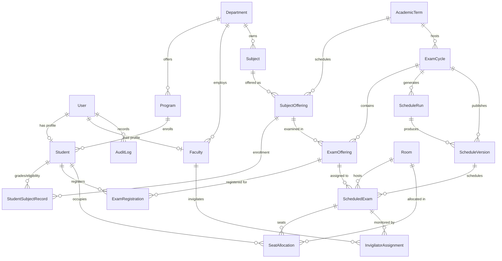

# Entity Relationship Diagram (ERD) & Database Schema

## Relational Architecture

---

## Key Invariants & Integrity Constraints

1. **Duplicate Registration Prevention**:
   - `ExamRegistration`: `@@unique([studentId, examOfferingId])`
   - *Invariant*: A student can never register for the same examination offering more than once.

2. **Seating Allocation Integrity**:
   - `SeatAllocation`: `@@unique([scheduledExamId, studentId])`
   - *Invariant*: A student cannot be seated in multiple desks for the same examination session.
   - `SeatAllocation`: `@@unique([scheduledExamId, roomId, seatLabel])`
   - *Invariant*: Two candidates cannot be allocated the exact same seat label in the same hall.

3. **Invigilator Collision Prevention**:
   - `InvigilatorAssignment`: `@@unique([scheduledExamId, facultyId])`
   - *Invariant*: A faculty member cannot be assigned twice to the same exam session.

4. **Immutable Published Versions**:
   - `ScheduleVersion`: `@@unique([examCycleId, versionNumber])`
   - *Invariant*: Schedule versions increment strictly (`v1.0`, `v2.0`). Published versions are locked against in-place mutations.

5. **Subject Offering Uniqueness**:
   - `SubjectOffering`: `@@unique([subjectId, academicTermId, semester])`
